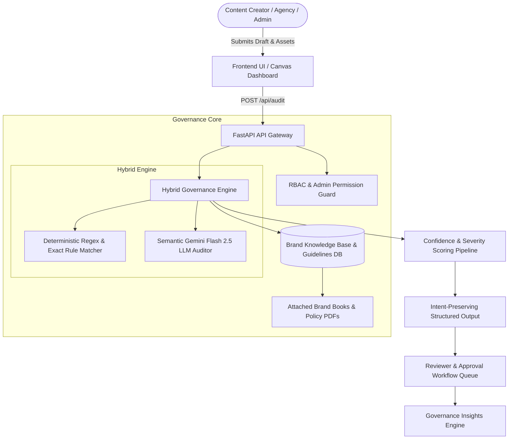

# Vertity AI — System Architecture & Engineering Specifications
**Inkloom AI Hackathon 2026**

## 1. High-Level Architecture Overview

Vertity AI is an autonomous, pre-publication brand governance engine designed to eradicate brand drift across 5 core dimensions: Outdated Facts, Unsupported Claims, Tone & Terminology, Visuals, and Accessibility.

---

## 2. Component Breakdown

### A. API Gateway & Microservices (`main.py`)
- **Framework:** FastAPI with ASGI async request pipeline.
- **CORS & Middleware:** Permissive development CORS with strict header isolation.
- **REST Endpoints:**
  - `POST /api/audit`: Main multi-modal audit ingestion point.
  - `GET /api/guidelines` & `POST /api/guidelines`: CRUD for enterprise brand rules.
  - `PUT /api/guidelines/{id}` & `DELETE /api/guidelines/{id}`: Admin-only rule lifecycle management.
  - `POST /api/guidelines/upload-doc`: Multipart document ingestion for supporting policy PDFs/DOCX.
  - `GET /api/submissions`: Live queue telemetry for pending and audited content.
  - `GET /api/analytics`: Governance drift intelligence and aggregate error patterns.

### B. AI & Semantic Auditing Engine (`ai_engine.py`)
- **Model:** Google Gemini Flash (`gemini-2.5-flash`) via `google-genai` SDK.
- **Deterministic Layer:** O(1) keyword and phrase scanning for instant policy violations (e.g. legacy pricing, blacklisted terms).
- **Semantic Layer:** Intent-preserving rewrite generation that minimizes word delta while enforcing tone standards.
- **Grounded Verification:** Every flag is mapped to a verified clause in the uploaded brand knowledge base. Hallucinations are actively suppressed by downgrading unverified advice to low-confidence suggestions.

### C. Frontend Interface (`frontend_app.html`)
- **Interactive Canvas:** Dynamic HTML5 2D particle mesh background simulating interconnected neural brand nodes.
- **Multi-Role RBAC Simulation:** Real-time persona switching across 4 Team Admins, External Creators, and Reviewers.
- **Design System:** Cyber-slate dark theme with Tailwind CSS, Lucide icons, and zero external JS framework overhead for instant sub-second rendering.

---

## 3. The 5 Brand Drift Pillars & Detection Logic

| Pillar | Example Drift | Detection Method | Resolution Strategy |
| :--- | :--- | :--- | :--- |
| **1. Outdated Facts** | "$49/mo legacy starter plan" | Deterministic Fact-Table Match | Replace with approved $79/mo Starter Tier |
| **2. Unsupported Claims** | "Fastest in the world", "#1" | Semantic LLM Claim Analysis | Downgrade to qualified claim: "Industry-leading" |
| **3. Tone & Terminology** | Using "clients" instead of approved vocabulary | Exact Nomenclature Dictionary | Auto-suggest "Growth Partners" |
| **4. Visual Compliance** | Off-brand hex palette in assets | Palette Hex Extraction | Flag deviation from Indigo (#6366F1) / Slate |
| **5. Accessibility** | Low contrast text on banner | WCAG 2.1 AA Contrast Math | Require 4.5:1 minimum luminance ratio |

---

## 4. Security & Governance Principles
1. **Zero Reject Philosophy:** Content is never discarded; actionable fixes with exact citations empower creators.
2. **Human-in-the-Loop:** Automated suggestions require explicit human approval before being committed to production.
3. **Data Isolation:** Draft content is never used to fine-tune external models.
